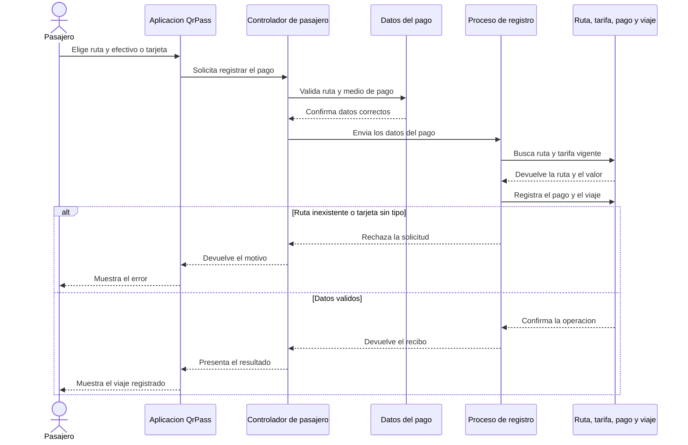
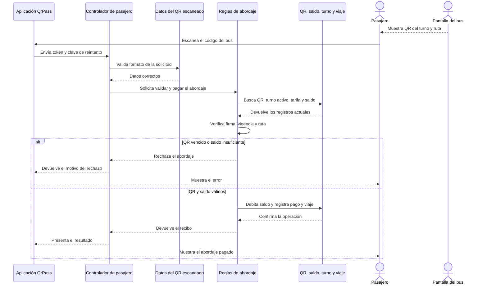
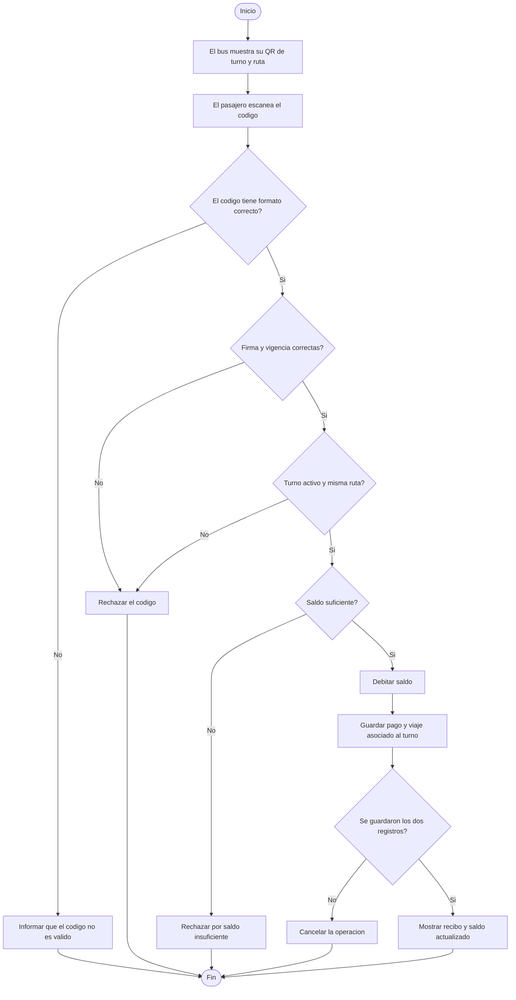
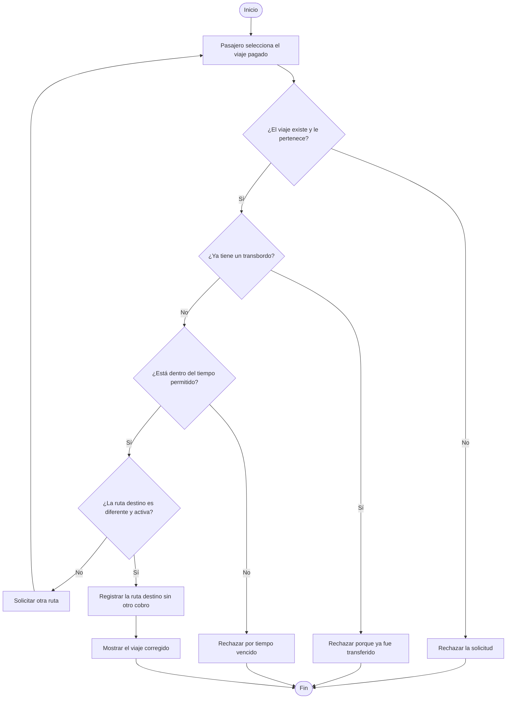

# MVC y entregables UML de QrPass

Este documento muestra dos procesos de QrPass: pagar al abordar escaneando el QR del bus y corregir un abordaje en la ruta equivocada mediante un transbordo. Los diagramas explican el recorrido con palabras sencillas y se relacionan con funciones reales del proyecto. Están escritos en Mermaid para poder revisarlos en GitHub o copiarlos a una herramienta UML.

## Decisión de arquitectura

QrPass usa MVC adaptado a una API web:

| Parte | Responsabilidad | Ubicación |
|---|---|---|
| Modelo | Entidades, relaciones y persistencia | `app/models/` |
| Vista | Interfaz web que presenta datos y recibe acciones | `frontend/` |
| Controlador | Recibe HTTP, usa autenticación/DTOs, llama servicios y forma respuestas | `app/controllers/` |
| Reglas de negocio | Valida pagos, QR, transbordos y turnos | `app/services.py` |

FastAPI convierte los controladores en endpoints HTTP. Los DTOs (`app/dtos/`) validan el contrato JSON de entrada y salida; complementan el modelo, no son otra capa MVC. `app/controllers/__init__.py` ensambla los controladores y `app/main.py` conecta ese router con la aplicación.

La separación es por responsabilidad, no por endpoint: `sistema.py`, `autenticacion.py`, `pasajero.py` y `conductor.py`. El ejemplo de Campo Vivo confirma el uso de carpetas `Controllers`, `Dtos` y `models`; QrPass conserva sus nombres en minúscula y español, y mantiene sus servicios porque allí ya están centralizadas las reglas.

## Secuencia 1: registrar un pago en efectivo o tarjeta

**Como se relaciona con Python:** `CrearPagoSolicitud` valida ruta y medio; `endpoint_pagar_viaje` llama a `crear_pago`; el servicio consulta ruta y tarifa y registra el pago y el viaje; `ReciboPago` forma la respuesta. Para pagar con saldo, la pantalla dirige al escaneo QR del bus.

## Secuencia 2: pasajero escanea el QR del bus

**Cómo se relaciona con Python:** el QR del turno se genera en `crear_qr_turno_conductor`; `ValidacionQrPasajeroSolicitud` revisa token y clave de reintento; `validar_qr_de_abordaje` comprueba la firma y el turno, descuenta el saldo y registra el viaje. `ReciboPago` representa la respuesta. Un QR vigente del bus puede servir a más de un pasajero.

## Actividad 1: pagar al abordar con el QR del bus

## Actividad 2: transbordo por abordar el bus equivocado

## Matriz de correspondencia UML y Python

| Elemento UML | Funcionalidad del proyecto | Implementación en Python | Evidencia |
|---|---|---|---|
| Clase | Representar pasajero, ruta, tarifa, pago y viaje | `Usuario`, `Ruta`, `Tarifa`, `Pago`, `Viaje` en `app/models/` | `tests/test_models_dtos.py` verifica entidades, relaciones y persistencia |
| Secuencia de pago | Registrar un pago en efectivo o tarjeta | `controllers/pasajero.py` llama `services.crear_pago`; el servicio consulta y guarda modelos | `tests/test_api.py`: pago en efectivo/tarjeta y errores de ruta/tipo de tarjeta |
| Secuencia QR | Pasajero paga escaneando el QR del bus | `controllers/conductor.py` genera el QR; `controllers/pasajero.py` llama `services.validar_qr_de_abordaje` | `tests/test_api.py`: abordaje válido, QR alterado/vencido, saldo insuficiente |
| Actividad QR | Validar turno/ruta, firma, vigencia y saldo antes del abordaje | `validar_qr_de_abordaje` aplica las reglas y registra pago/viaje dentro de una transaccion | `tests/test_api.py`: QR valido, firma alterada, vencimiento, ruta incorrecta y saldo insuficiente |
| Actividad transbordo | Corregir el abordaje si se eligio un bus equivocado | `crear_transbordo` valida propiedad, tiempo, ruta distinta y unicidad | `tests/test_api.py`: transbordo permitido y condiciones rechazadas |

## Análisis

**¿Cómo representa el código los diagramas?** Cada mensaje de la secuencia corresponde a una llamada concreta: el frontend solicita el endpoint, FastAPI valida DTO y permisos, el controlador llama una función de servicio, el servicio consulta o modifica modelos ORM y retorna el resultado que el controlador convierte a DTO de respuesta. Las decisiones de actividad corresponden a `if`, consultas condicionales y excepciones de dominio.

**¿Qué inconsistencias había entre diseño e implementación?** El primer flujo atribuía el QR al pasajero y hacía que el conductor lo escaneara. El proceso esperado es el contrario: el bus muestra el código y el pasajero lo escanea. También se aclaró que el transbordo se usa para corregir una equivocación de bus, no para cambiar de ruta por conveniencia.

**¿Qué modificaciones fueron necesarias?** El turno del conductor ahora genera un QR firmado ligado a su ruta y turno. El pasajero envía el QR para que el backend valide la operación, descuente su saldo y registre el viaje. La interfaz explica que el transbordo sirve para corregir un abordaje equivocado. La pantalla del conductor representa el dispositivo del bus; el aparato físico todavía no está conectado.

**¿Cómo ayuda UML a reducir errores?** Hace visibles el orden de llamadas, las validaciones y los resultados alternativos antes de cambiar código. La matriz permite cotejar cada paso del diagrama con un método y una prueba, lo que ayuda a detectar validaciones omitidas, responsabilidades mezcladas y respuestas que no coinciden.
