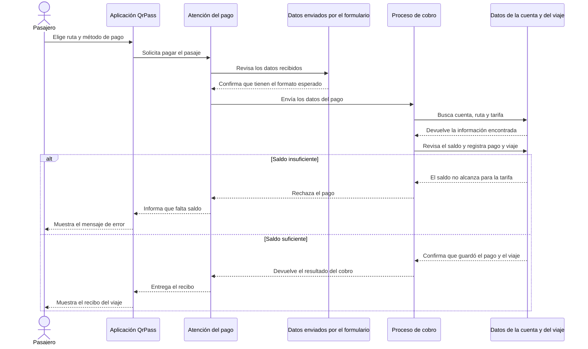
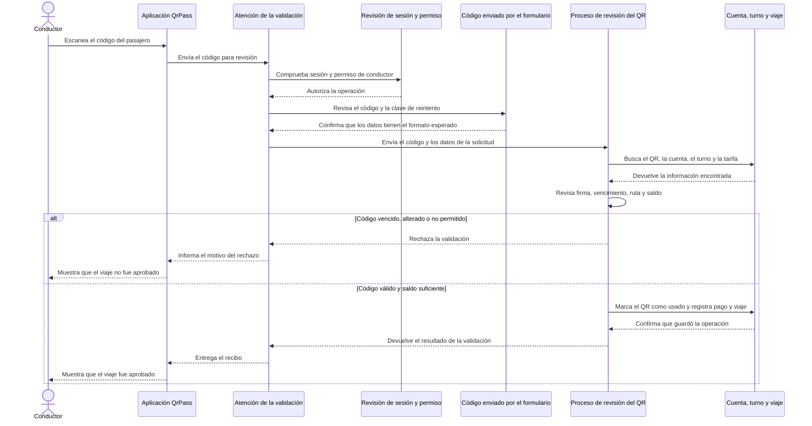
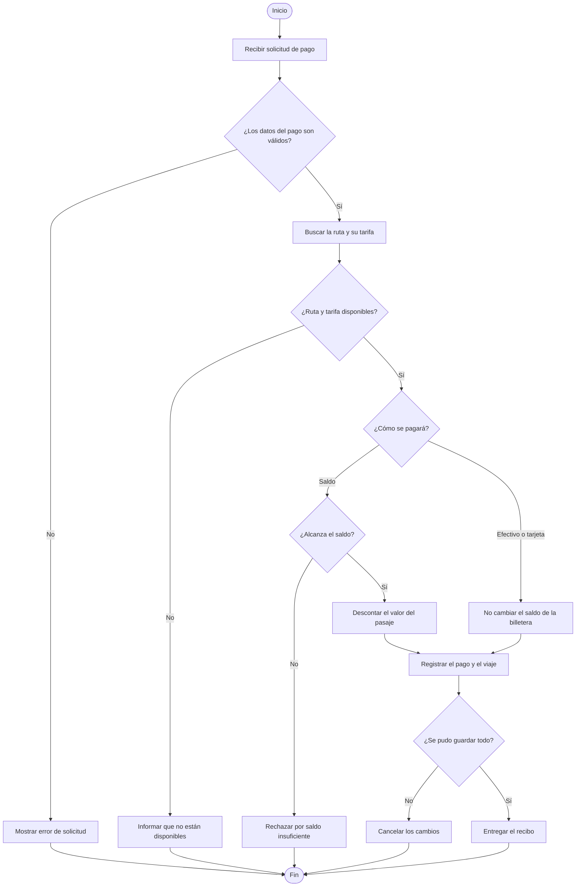
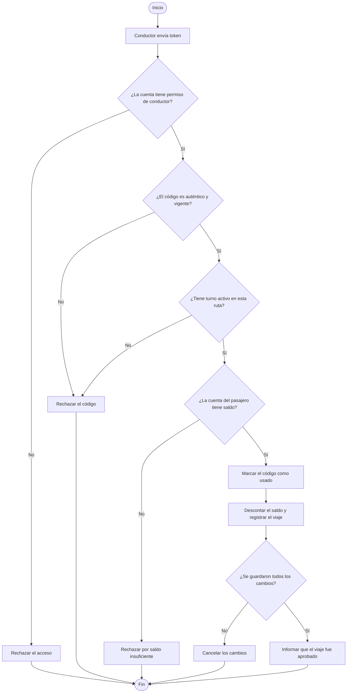

# MVC y entregables UML de QrPass

Este documento muestra cómo funcionan dos procesos de QrPass: pagar un pasaje y validar un QR. Los diagramas explican el recorrido del proceso con palabras sencillas; no son diagramas de la arquitectura del backend. Debajo de cada uno se indica qué funciones de Python realizan esos pasos. Están escritos en Mermaid para poder revisarlos en GitHub o copiarlos a una herramienta UML.

## Decisión de arquitectura

QrPass usa MVC adaptado a una API web:

| Parte | Responsabilidad | Ubicación |
|---|---|---|
| Modelo | Entidades, relaciones y persistencia | `app/models/` |
| Vista | Interfaz web que presenta datos y recibe acciones | `frontend/` |
| Controlador | Recibe HTTP, usa autenticación/DTOs, llama servicios y forma respuestas | `app/controllers/` |
| Reglas de negocio | Valida pagos, QR, transbordos y turnos | `app/services.py` |

FastAPI convierte los controladores en endpoints HTTP. Los DTOs (`app/dtos/`) validan el contrato JSON de entrada y salida; complementan el modelo, no son otra capa MVC. `app/controllers/__init__.py` ensambla los controladores y `app/main.py` conecta ese router con la aplicación.

La separación es por responsabilidad, no por endpoint: `sistema.py`, `autenticacion.py`, `pasajero.py` y `conductor.py`. El ejemplo de Campo Vivo confirma el uso de carpetas `Controllers`, `Dtos` y `models`; QrPass conserva sus nombres en minúscula y español, y mantiene sus servicios porque allí ya están centralizadas las reglas.

## Secuencia 1: pagar un viaje con saldo

**Cómo se relaciona con Python:** FastAPI valida los datos con `CrearPagoSolicitud` y luego llama a `endpoint_pagar_viaje`; el controlador llama a `crear_pago`; finalmente, `ReciboPago` forma la respuesta. Si falta saldo, el servicio rechaza el cobro. Si alcanza, guarda el pago y el viaje juntos.

## Secuencia 2: conductor valida un QR

**Cómo se relaciona con Python:** la sesión y el rol se comprueban con `requerir_rol("DRIVER")`; `ValidacionQrConductorSolicitud` revisa los datos recibidos; `validar_y_canjear_qr` aplica las reglas; y `ReciboPago` representa la respuesta. El servicio rechaza códigos inválidos y registra el pago solo si todas las condiciones se cumplen.

## Actividad 1: pago de un viaje

## Actividad 2: validar QR de viaje

## Matriz de correspondencia UML y Python

| Elemento UML | Funcionalidad del proyecto | Implementación en Python | Evidencia |
|---|---|---|---|
| Clase | Representar pasajero, ruta, tarifa, pago y viaje | `Usuario`, `Ruta`, `Tarifa`, `Pago`, `Viaje` en `app/models/` | `tests/test_models_dtos.py` verifica entidades, relaciones y persistencia |
| Secuencia de pago | Cobrar un viaje con billetera, efectivo o tarjeta | `controllers/pasajero.py` llama `services.crear_pago`; el servicio consulta y guarda modelos | `tests/test_api.py`: pago de billetera, efectivo/tarjeta, saldo insuficiente y rollback |
| Secuencia QR | Validar QR del pasajero desde el turno del conductor | `controllers/conductor.py` llama `services.validar_y_canjear_qr` | `tests/test_api.py`: QR válido, firma alterada, vencimiento, ruta incorrecta y rollback |
| Actividad de pago | Validar solicitud, ruta, tarifa, saldo y persistencia | Condiciones en `crear_pago`; DTO limita combinaciones de medio y tipo de tarjeta | Pruebas de medio inválido y saldo insuficiente |
| Actividad QR | Autorizar solo QR válido durante turno/ruta apropiados | Validaciones de firma, estado, vencimiento, turno y saldo en `validar_y_canjear_qr` | Pruebas de firma alterada, QR vencido, otra ruta y canje exitoso |

## Análisis

**¿Cómo representa el código los diagramas?** Cada mensaje de la secuencia corresponde a una llamada concreta: el frontend solicita el endpoint, FastAPI valida DTO y permisos, el controlador llama una función de servicio, el servicio consulta o modifica modelos ORM y retorna el resultado que el controlador convierte a DTO de respuesta. Las decisiones de actividad corresponden a `if`, consultas condicionales y excepciones de dominio.

**¿Qué inconsistencias había entre diseño e implementación?** Las rutas actuaban como controladores, pero el nombre `routes.py` y su concentración ocultaban esa responsabilidad. También conviven las rutas del usuario (`/demo/account/payments`) y las del conductor (`/driver/qr/validate`): son dos entradas distintas al cobro y una debe recibir el QR generado por la otra.

**¿Qué modificaciones fueron necesarias?** Se agruparon los endpoints existentes en cuatro módulos de controladores, se actualizó `main.py` para cargar su router y se eliminó el archivo `routes.py`. Los modelos, DTOs y servicios mantienen sus responsabilidades actuales. No se duplicaron reglas ni se agregaron clases vacías solo para cumplir nombres de arquitectura.

**¿Cómo ayuda UML a reducir errores?** Hace visibles el orden de llamadas, las validaciones y los resultados alternativos antes de cambiar código. La matriz permite cotejar cada paso del diagrama con un método y una prueba, lo que ayuda a detectar validaciones omitidas, responsabilidades mezcladas y respuestas que no coinciden.
