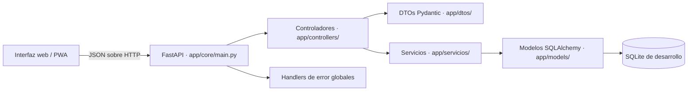

# 7. Diseño del sistema

## 7.1 Arquitectura propuesta

La arquitectura sigue un estilo cliente-servidor con API REST. La interfaz (PWA) consume la API mediante JSON sobre HTTP. El backend se organiza en capas: controladores, servicios, modelos y base de datos.

**Figura 1. Arquitectura de componentes de QrPass.**

## 7.2 Diagramas UML

Se incluyen diagramas de clases, secuencia y actividades.

**Figura 3. Modelo entidad-relación del dominio.** (Ver `documentacion/arquitectura.md`.)

**Figura 4. Secuencia de pago manual.** (Ver `documentacion/arquitectura.md`.)

**Figura 5. Secuencia de generación y validación de QR.** (Ver `documentacion/arquitectura.md`.)

## 7.3 Diseño de interfaz de usuario

La interfaz es una PWA adaptable con vistas para pasajero y conductor. Se prioriza la claridad de mensajes de éxito y error para usuarios no expertos. Los formularios validan campos en el cliente y muestran mensajes del backend.

## 7.4 Contrato de integración (resumen)

Cada requerimiento funcional se mapea a un endpoint, una solicitud y una respuesta. Ver Anexo E.

## Referencias

- Bass, L., Clements, P., & Kazman, R. (2021). *Software architecture in practice* (4.ª ed.). Addison-Wesley.
- Fowler, M. (2018). *Patterns of enterprise application architecture*. Addison-Wesley.