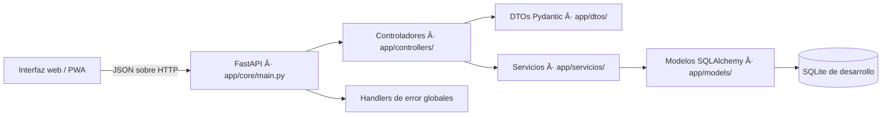

# QrPass: Plataforma de recaudo digital para el transporte público de Ibagué

**Portada**

- **Nombre del proyecto:** QrPass — Sistema de pago y recaudo digital con código QR para el transporte público de Ibagué.
- **Integrantes del equipo:** Equipo de desarrollo QrPass (Ingeniería de Sistemas).
- **Curso y docente:** Ingeniería de Software — [Nombre del docente].
- **Fecha:** Noviembre de 2026.
- **Repositorio:** `C:\Users\nicol\Downloads\GitHub\QrPass` (rama `main`).

---

## Índice

1. [Portada](./00_PORTADA.md)
2. [Resumen ejecutivo](./01_RESUMEN_EJECUTIVO.md)
3. [Planteamiento del problema](./02_PLANTEAMIENTO_DEL_PROBLEMA.md)
4. [Objetivos](./03_OBJETIVOS.md)
5. [Requisitos del sistema](./04_REQUISITOS_DEL_SISTEMA.md)
6. [Análisis de usuarios y casos de uso](./05_ANALISIS_USUARIOS_CASOS_USO.md)
7. [Diseño del sistema](./06_DISENO_DEL_SISTEMA.md)
8. [Planificación del proyecto](./07_PLANIFICACION_DEL_PROYECTO.md)
9. [Metodología ágil seleccionada](./08_METODOLOGIA_AGIL.md)
10. [Desarrollo e implementación](./09_DESARROLLO_IMPLEMENTACION.md)
11. [Pruebas](./10_PRUEBAS.md)
12. [Conclusiones y recomendaciones](./11_CONCLUSIONES_RECOMENDACIONES.md)
13. [Referencias](./12_REFERENCIAS.md)
14. [Anexos](./ANEXOS/ANEXO_A_CODIGO_ESTRUCTURA.md)

---

## Lista de tablas

- Tabla 1. Requisitos funcionales del sistema.
- Tabla 2. Requisitos no funcionales del sistema.
- Tabla 3. Reglas de negocio.
- Tabla 4. Actores del sistema.
- Tabla 5. Casos de uso principales.
- Tabla 6. Tecnologías y herramientas utilizadas.
- Tabla 7. Cronograma del proyecto.
- Tabla 8. Casos de prueba ejecutados.
- Tabla 9. Colección de endpoints principales.
- Tabla 10. Cuentas de demostración.

---

## Lista de figuras

- Figura 1. Arquitectura de componentes de QrPass.
- Figura 2. Flujo de pago mediante código QR del bus.
- Figura 3. Modelo entidad-relación del dominio.
- Figura 4. Secuencia de pago manual en efectivo o tarjeta.
- Figura 5. Secuencia de generación y validación de QR.

---

*Documento elaborado conforme a la Guía para el Proyecto de Ingeniería de Software y a las normas APA (7.ª edición) para las referencias.*

---

# 2. Resumen ejecutivo

## 2.1 Descripción breve del proyecto

QrPass es un prototipo funcional de plataforma de pago y recaudo digital para el transporte público de Ibagué. El sistema permite que un pasajero consulte rutas y tarifas, gestione una billetera virtual, realice pagos mediante el escaneo del código QR que muestra el bus y consulte su historial de viajes. De forma paralela, el conductor inicia un turno, genera un QR temporal firmado, registra pagos manuales y cierra el turno con conciliación de efectivo (Hernández & Pressman, 2021; Sommerville, 2016).

La solución se compone de una interfaz web adaptable y progresiva (PWA) y de una API REST construida con FastAPI, SQLAlchemy 2 y Pydantic. Los datos se persisten en SQLite durante el desarrollo y la demostración. Todas las operaciones son de demostración: no se procesa dinero real ni se integran pasarelas bancarias.

## 2.2 Objetivo general

Desarrollar un prototipo de sistema de recaudo digital basado en códigos QR firmados que permita validar el flujo completo de pago, traspaso y conciliación de turnos en el transporte público de Ibagué, con trazabilidad de requisitos y evidencia de pruebas automatizadas.

## 2.3 Alcance

**Dentro del alcance (demostración):**

- Registro y autenticación de pasajeros y conductores con roles.
- Billetera virtual, recargas ficticias e idempotentes y consulta de saldo.
- Pago de pasaje mediante escaneo del QR del bus (firma HMAC, vigencia y asociación al turno).
- Pago manual simulado en efectivo o tarjeta.
- Traspaso único a otra ruta dentro de 20 minutos.
- Tarifa dinámica por ruta, día hábil, fin de semana y festivo colombiano.
- Historial de viajes y movimientos.
- Gestión de turnos del conductor: inicio, registro de pagos, generación de QR y cierre con conciliación.
- Documentación de ingeniería de software, arquitectura, UML y trazabilidad.

**Fuera del alcance (pendiente para producción):**

- Procesamiento de dinero real y pasarelas POS/bancarias.
- Sincronización offline operativa por lotes.
- Firma asimétrica para validadores sin conexión.
- Migraciones versionadas sobre base productiva.
- Pruebas de concurrencia, carga y seguridad avanzada.

## 2.4 Público objetivo

El sistema se orienta a tres actores: pasajeros (usuarios finales del servicio), conductores (operadores del bus) y personal técnico/administrativo encargado de la operación y el soporte. La documentación y las cuentas de demostración permiten que jurados, docentes y nuevos desarrolladores comprendan y validen el prototipo sin conocimiento previo del dominio.

## Referencias

- Hernández, R. K., & Pressman, R. S. (2021). *Software engineering: A practitioner's approach* (9.ª ed.). McGraw-Hill.
- Sommerville, I. (2016). *Software engineering* (10.ª ed.). Pearson.

---

# 3. Planteamiento del problema

## 3.1 Contexto o situación actual

El transporte público en Ibagué enfrenta retos de recaudo: dependencia de efectivo, dificultad para conciliar turnos, riesgo de fraude y poca trazabilidad de los pagos. Los pasajeros no cuentan con un mecanismo ágil para pagar sin efectivo ni para consultar sus viajes. Los conductores deben registrar manualmente los cobros y cerrar turnos con diferencias de caja (Sommerville, 2016).

## 3.2 Necesidad o problema a resolver

Se requiere una solución que permita:

1. Registrar pagos de pasaje de forma digital y trazable.
2. Validar el pago mediante un código QR firmado asociado al turno y a la ruta del bus.
3. Evitar cobros duplicados mediante claves de idempotencia.
4. Mantener una billetera virtual por pasajero con saldo no negativo.
5. Permitir traspasos a otra ruta dentro de una ventana de 20 minutos.
6. Aplicar tarifas dinámicas por ruta y tipo de día (hábil, fin de semana, festivo).
7. Consolidar el recaudo por turno y cerrar con conciliación de efectivo.

## 3.3 Justificación del proyecto

QrPass demuestra, de extremo a extremo, el flujo de recaudo digital: desde la captura de la acción del usuario en la interfaz, la solicitud HTTP al endpoint correcto, la aplicación de validaciones y reglas de negocio en el backend, hasta la persistencia en la base de datos y la respuesta visible al usuario. La evidencia incluye casos exitosos y casos de error, lo que facilita la evaluación académica y la transferencia a un entorno productivo (Pressman & Maxim, 2020).

## Referencias

- Pressman, R. S., & Maxim, B. R. (2020). *Software engineering: A practitioner's approach* (9.ª ed.). McGraw-Hill.
- Sommerville, I. (2016). *Software engineering* (10.ª ed.). Pearson.

---

# 4. Objetivos

## 4.1 Objetivo general

Diseñar e implementar un prototipo de plataforma de recaudo digital con códigos QR firmados para el transporte público de Ibagué, que permita validar flujos de pago, traspaso y conciliación de turnos con trazabilidad de requisitos y pruebas automatizadas.

## 4.2 Objetivos específicos

1. Implementar la autenticación y autorización por roles (pasajero y conductor) mediante tokens bearer firmados con HMAC.
2. Modelar el dominio de transporte (usuarios, roles, rutas, tarifas, turnos, pagos, viajes, QR y transbordos) en SQLAlchemy.
3. Construir una API REST con validaciones de entrada y salida mediante DTOs Pydantic.
4. Desarrollar una interfaz web adaptable (PWA) que consuma la API y muestre respuestas y errores de forma intuitiva.
5. Garantizar propiedades ACID en las transacciones de débito, recarga y pago.
6. Aplicar tarifas dinámicas según ruta, día hábil, fin de semana y festivo colombiano.
7. Validar el flujo de integración completo (pantalla → JavaScript → API → backend → base de datos) con casos exitosos y de error.
8. Documentar la arquitectura, los casos de uso, las pruebas y la trazabilidad de requisitos bajo normas APA 7.

## Referencias

- Pressman, R. S., & Maxim, B. R. (2020). *Software engineering: A practitioner's approach* (9.ª ed.). McGraw-Hill.

---

# 5. Requisitos del sistema

## 5.1 Requisitos funcionales

**Tabla 1. Requisitos funcionales del sistema.**

| ID | Descripción | Endpoint principal |
|---|---|---|
| RF-01 | Registro y autenticación de pasajero | `POST /api/v1/auth/register`, `POST /api/v1/auth/login` |
| RF-02 | Consulta de identidad y roles | `GET /api/v1/auth/me` |
| RF-03 | Billetera y saldo | `GET /api/v1/demo/account` |
| RF-04 | Recarga ficticia e idempotente | `POST /api/v1/demo/account/top-ups` |
| RF-05 | Pago manual (efectivo/tarjeta) | `POST /api/v1/demo/account/payments` |
| RF-06 | Pago mediante QR del bus | `POST /api/v1/demo/account/qr/validate` |
| RF-07 | Traspaso a otra ruta (≤ 20 min) | `POST /api/v1/demo/account/transfers` |
| RF-08 | Historial de viajes y movimientos | `GET /api/v1/trips`, `GET /api/v1/payments/history` |
| RF-09 | Tarifa vigente por ruta y día | `GET /api/v1/fares/current` |
| RF-10 | Gestión de turno del conductor | `POST /api/v1/driver/shift/start`, `GET /api/v1/driver/shift` |
| RF-11 | Generación de QR del turno | `POST /api/v1/driver/shift/qr` |
| RF-12 | Registro de pagos del conductor | `POST /api/v1/driver/shift/payments` |
| RF-13 | Cierre y conciliación de turno | `POST /api/v1/driver/shift/close` |
| RF-14 | Estado del servicio | `GET /api/v1/health`, `GET /api/v1/ready` |

### 5.1.1 Descripción detallada de requisitos funcionales

- **RF-01:** El sistema debe permitir el registro de pasajeros con nombres, correo y contraseña. El correo debe ser único y la contraseña tener al menos 12 caracteres.
- **RF-04:** La recarga debe ser idempotente mediante clave; montos entre $1 y $500.000.
- **RF-06:** El QR debe estar firmado con HMAC, vencer en 15 minutos y asociarse al turno activo.
- **RF-07:** El traspaso solo se permite una vez por viaje, entre rutas distintas y dentro de 20 minutos.
- **RF-09:** La tarifa depende de la ruta, el destino y el tipo de día (hábil $3.300, fin de semana/festivo $3.400).
- **RF-13:** El cierre de turno consolida efectivo, QR y tarjeta, y calcula la diferencia.

## 5.2 Requisitos no funcionales

**Tabla 2. Requisitos no funcionales del sistema.**

| ID | Descripción | Verificación |
|---|---|---|
| RNF-01 | Tiempo de respuesta < 1,5 s en operaciones críticas | Pruebas de carga (pendiente) |
| RNF-02 | Propiedades ACID en transacciones | `test_failed_payment_commit_rolls_back...` |
| RNF-03 | Cifrado de credenciales (hash) | Inspección de código |
| RNF-04 | Validación de entrada mediante DTOs | Pruebas de validación |
| RNF-05 | Disponibilidad verificable | `test_readiness_checks_database...` |
| RNF-06 | Interfaz adaptable y PWA | Revisión manual |
| RNF-07 | Mensajes de error intuitivos | Revisión de UX |

## 5.3 Reglas de negocio

**Tabla 3. Reglas de negocio.**

| ID | Regla | Implementación |
|---|---|---|
| RN-01 | Saldo nunca negativo | `CheckConstraint` + servicio |
| RN-02 | Recargas > 0 y ≤ $500.000 | DTO `CrearRecargaSolicitud` |
| RN-03 | Idempotencia de pagos | Clave única por usuario |
| RN-04 | QR válido 15 min y firmado | `servicios/qr.py` |
| RN-05 | Un pasajero no paga dos veces con el mismo QR | Consumo de QR |
| RN-06 | Traspaso ≤ 20 min y rutas distintas | `servicios/transbordos.py` |
| RN-07 | Tarifa dinámica por día | `servicios/rutas_tarifas.py` |
| RN-08 | Pago con saldo requiere QR | Validación en servicio |
| RN-09 | Cuentas nuevas solo pasajero | `registrar_pasajero` |
| RN-10 | Toda solicitud recibe respuesta HTTP | Handlers globales |

## Referencias

- Pressman, R. S., & Maxim, B. R. (2020). *Software engineering: A practitioner's approach* (9.ª ed.). McGraw-Hill.
- Sommerville, I. (2016). *Software engineering* (10.ª ed.). Pearson.

---

# 6. Análisis de usuarios y casos de uso

## 6.1 Identificación de actores

**Tabla 4. Actores del sistema.**

| Actor | Descripción | Permisos |
|---|---|---|
| Pasajero | Usuario final del servicio | Consultar rutas, recargar, pagar, transferir, historial |
| Conductor | Operador del bus | Iniciar/cerrar turno, generar QR, registrar pagos |
| Sistema QrPass | Backend | Validar, persistir, responder |
| Jurado/Docente | Evaluador | Consultar documentación y demo |

## 6.2 Diagramas de casos de uso

Los casos de uso se agrupan en: autenticación, billetera, pagos, traspasos, turnos y consulta. El diagrama UML se incluye en `documentacion/arquitectura.md`.

## 6.3 Descripción de escenarios

**Tabla 5. Casos de uso principales.**

| ID | Caso de uso | Actor | Descripción resumida | Precondición | Postcondición |
|---|---|---|---|---|---|
| CU-01 | Registrarse | Pasajero | Crea cuenta | Correo no registrado | Cuenta activa |
| CU-02 | Iniciar sesión | Pasajero/Conductor | Obtiene token | Credenciales válidas | Token emitido |
| CU-03 | Consultar saldo | Pasajero | Visualiza billetera | Sesión activa | Saldo mostrado |
| CU-04 | Recargar saldo | Pasajero | Acredita monto | Sesión activa | Saldo incrementado |
| CU-05 | Pagar con QR | Pasajero | Escanea QR y debita | QR válido y saldo suficiente | Viaje creado |
| CU-06 | Pagar manual | Pasajero/Conductor | Registra pago | Ruta válida | Viaje creado |
| CU-07 | Transferirse | Pasajero | Traspaso a otra ruta | Viaje reciente (≤20 min) | Traspaso registrado |
| CU-08 | Consultar historial | Pasajero | Lista viajes/movimientos | Sesión activa | Historial mostrado |
| CU-09 | Iniciar turno | Conductor | Asocia ruta y vehículo | Rol DRIVER | Turno activo |
| CU-10 | Generar QR | Conductor | Crea QR firmado | Turno activo | QR disponible |
| CU-11 | Cerrar turno | Conductor | Concilia y finaliza | Turno activo | Turno cerrado |

### 6.3.1 Escenario detallado: CU-05 Pagar con QR

1. El conductor inicia turno y genera QR.
2. El pasajero escanea el QR desde la interfaz.
3. La API valida firma, vigencia y turno/ruta.
4. Se debita el saldo y se crea el viaje.
5. Se retorna recibo y saldo actualizado.
6. Caso de error: saldo insuficiente → 409, sin cambios.

## Referencias

- Jacobson, I., Booch, G., & Rumbaugh, J. (1999). *The unified software development process*. Addison-Wesley.
- Pressman, R. S., & Maxim, B. R. (2020). *Software engineering: A practitioner's approach* (9.ª ed.). McGraw-Hill.

---

# 7. Diseño del sistema

## 7.1 Arquitectura propuesta

La arquitectura sigue un estilo cliente-servidor con API REST. La interfaz (PWA) consume la API mediante JSON sobre HTTP. El backend se organiza en capas: controladores, servicios, modelos y base de datos.

**Figura 1. Arquitectura de componentes de QrPass.**

## 7.2 Diagramas UML

Se incluyen diagramas de clases, secuencia y actividades.

**Figura 3. Modelo entidad-relación del dominio.** (Ver `documentacion/arquitectura.md`.)

**Figura 4. Secuencia de pago manual.** (Ver `documentacion/arquitectura.md`.)

**Figura 5. Secuencia de generación y validación de QR.** (Ver `documentacion/arquitectura.md`.)

## 7.3 Diseño de interfaz de usuario

La interfaz es una PWA adaptable con vistas para pasajero y conductor. Se prioriza la claridad de mensajes de éxito y error para usuarios no expertos. Los formularios validan campos en el cliente y muestran mensajes del backend.

## 7.4 Contrato de integración (resumen)

Cada requerimiento funcional se mapea a un endpoint, una solicitud y una respuesta. Ver Anexo E.

## Referencias

- Bass, L., Clements, P., & Kazman, R. (2021). *Software architecture in practice* (4.ª ed.). Addison-Wesley.
- Fowler, M. (2018). *Patterns of enterprise application architecture*. Addison-Wesley.

---

# 8. Planificación del proyecto

## 8.1 Cronograma

**Tabla 7. Cronograma del proyecto.**

| Fase | Actividad | Semanas | Entregable |
|---|---|---|---|
| 1 | Análisis de requisitos | 1-2 | Documento de requisitos |
| 2 | Diseño de arquitectura y UML | 3-4 | Diagramas y modelo |
| 3 | Implementación del backend | 5-8 | API funcional |
| 4 | Implementación del frontend (PWA) | 6-9 | Interfaz funcional |
| 5 | Pruebas y correcciones | 9-10 | Reporte de pruebas |
| 6 | Documentación y entrega | 10-11 | Informe final |

## 8.2 Asignación de tareas

| Rol | Responsabilidad |
|---|---|
| Backend | API, servicios, modelos, pruebas |
| Frontend | Interfaz, PWA, integración |
| Documentación | Ingeniería de software, UML, trazabilidad |

## 8.3 Herramientas y tecnologías

**Tabla 6. Tecnologías y herramientas utilizadas.**

| Componente | Tecnología | Versión |
|---|---|---|
| Backend | Python | 3.10 |
| Framework API | FastAPI | 0.x |
| ORM | SQLAlchemy | 2.x |
| Validación | Pydantic | 2.x |
| Base de datos | SQLite | 3.x |
| Frontend | HTML5/CSS3/JS | - |
| Pruebas | pytest | 8.x |
| Control de versiones | Git | - |
| Diagramas | Mermaid | - |

## Referencias

- Schwaber, K., & Sutherland, J. (2020). *The Scrum guide*. Scrum.org. https://scrumguides.org/

---

# 9. Metodología ágil seleccionada

El equipo seleccionó **Scrum** por su adaptación a proyectos académicos iterativos, con entregas incrementales y revisión continua. Se justifica por la necesidad de validar flujos funcionales (pago, QR, turno) de forma temprana y ajustar requisitos con el docente.

## Roles

- **Product Owner:** docente/cliente.
- **Scrum Master:** líder del equipo.
- **Equipo de desarrollo:** backend, frontend, documentación.

## Artefactos

- **Product Backlog:** requisitos RF/RNF.
- **Sprint Backlog:** tareas por sprint.
- **Incremento:** prototipo funcional.

## Eventos

- Sprint Planning, Daily Scrum, Sprint Review, Sprint Retrospective.

## Justificación

Scrum permite inspeccionar y adaptar el producto en ciclos cortos, lo que facilita corregir errores de integración y validar el contrato de la API con el frontend.

## Referencias

- Schwaber, K., & Sutherland, J. (2020). *The Scrum guide*. Scrum.org. https://scrumguides.org/

---

# 10. Desarrollo e implementación

## 10.1 Lenguajes y frameworks utilizados

- **Backend:** Python 3.10, FastAPI, SQLAlchemy 2, Pydantic, Uvicorn.
- **Frontend:** HTML5, CSS3, JavaScript (PWA con Service Worker).
- **Base de datos:** SQLite.
- **Pruebas:** pytest, FastAPI TestClient.

## 10.2 Estructura del código

Ver Anexo A. El backend se organiza en capas: `core/`, `controllers/`, `dtos/`, `models/`, `seguridad/`, `servicios/`.

## 10.3 Evidencias del desarrollo

El repositorio se gestionó con Git. El historial incluye refactorizaciones por responsabilidad, rediseño premium del frontend, correcciones de codificación (UTF-8) y adición de endpoints `/` y `/health`.

## 10.4 Control de versiones

Se utiliza Git con commits descriptivos en español. La rama `main` se mantiene sincronizada con `origin/main`.

## 10.5 Manejo de errores

Se implementaron handlers globales para validación (422), dominio (409/401/etc.) y errores inesperados (500), con mensajes en español e indicación del campo.

## 10.6 Flujo de integración (según evidencia PNG)

El prototipo cumple el flujo exigido para la evidencia final de integración:

1. La interfaz captura una acción del usuario (formularios de login, registro, pago, recarga, QR, traspaso, turno).
2. JavaScript envía la solicitud al endpoint correcto mediante `fetch` (`apiRequest` en `frontend/app.js`).
3. El backend aplica validaciones (DTOs Pydantic) y reglas de negocio (servicios).
4. La base de datos refleja la operación (SQLAlchemy, transacciones ACID).
5. La API devuelve una respuesta JSON y la interfaz la muestra (toasts, tablas, recibos).
6. Se explica un caso exitoso y un caso de error (pruebas CP-01 a CP-12 y documentación de pruebas).

**Ruta de integración:** probar la API → crear la pantalla → mostrar la respuesta → manejar errores → actualizar el DOM. Se utilizan códigos HTTP estándar (200, 201, 400, 401, 403, 404, 409, 410, 422, 500, 503) y `fetch` para todas las solicitudes.

## Referencias

- Chacon, S., & Straub, B. (2014). *Pro Git* (2.ª ed.). Apress. https://git-scm.com/book/

---

# 11. Pruebas

## 11.1 Estrategia de pruebas

Se aplican pruebas unitarias e integradas con pytest. Las pruebas de modelos y DTOs verifican persistencia y validaciones. Las pruebas de integración usan FastAPI TestClient con base SQLite en memoria, validando flujos completos y casos de error.

## 11.2 Casos de prueba

**Tabla 8. Casos de prueba ejecutados.**

| ID | Caso | Resultado esperado | Estado |
|---|---|---|---|
| CP-01 | Health y rutas | 200 y 32 rutas | Aprobado |
| CP-02 | Login pasajero/conductor | 200 y roles correctos | Aprobado |
| CP-03 | Registro de pasajero | 201 y rol PASSENGER | Aprobado |
| CP-04 | Pago idempotente | Mismo payment_id | Aprobado |
| CP-05 | Rollback ante fallo | Saldo sin cambios | Aprobado |
| CP-06 | QR firmado y consumo único | 201 y 409 en duplicado | Aprobado |
| CP-07 | Traspaso expirado | 409 | Aprobado |
| CP-08 | Top-up límites | 422 si > $500.000 | Aprobado |
| CP-09 | Insuficiencia de saldo | 409 | Aprobado |
| CP-10 | Tarifas por día | Montos correctos | Aprobado |
| CP-11 | Validación de formularios | 422 con campo | Aprobado |
| CP-12 | Readiness sin BD | 503 | Aprobado |

## 11.3 Resultados

Ejecución: `27 passed, 1 warning` (pytest, base SQLite en memoria). La advertencia corresponde a un campo deprecado de Pydantic (`exclude_none`), sin impacto funcional.

## 11.4 Cobertura

Las pruebas cubren flujos de autenticación, pagos, QR, traspasos, turnos y validaciones. Pendiente: pruebas de concurrencia y carga.

## Referencias

- Myers, G. J., Sandler, C., & Badgett, T. (2011). *The art of software testing* (3.ª ed.). Wiley.

---

# 12. Conclusiones y recomendaciones

## 12.1 Logros alcanzados

- Se implementó un prototipo funcional de recaudo digital con QR firmado, traspasos y conciliación de turnos.
- Se validó el flujo de integración completo (pantalla → JavaScript → API → backend → base de datos) con casos exitosos y de error.
- Se documentó la arquitectura, los requisitos, las pruebas y la trazabilidad.
- Las 27 pruebas automatizadas pasan correctamente.
- Se mejoró el manejo de errores con mensajes intuitivos por campo.

## 12.2 Dificultades encontradas

- Manejo de codificación (UTF-8) en consola Windows y Swagger.
- Refactorización de un servicio monolítico a módulos por responsabilidad.
- Alineación entre el esquema formal y la implementación demo.

## 12.3 Posibles mejoras

- Implementar migraciones versionadas.
- Añadir pruebas de concurrencia y carga.
- Integrar pasarela POS/bancaria real.
- Implementar sincronización offline por lotes.
- Validación de edad en registro (mínimo 5 años).
- Mejorar mensajes de error para usuarios no expertos.

## Referencias

- Sommerville, I. (2016). *Software engineering* (10.ª ed.). Pearson.

---

# 13. Referencias

Las referencias se presentan en formato APA (7.ª edición).

- Bass, L., Clements, P., & Kazman, R. (2021). *Software architecture in practice* (4.ª ed.). Addison-Wesley.
- Chacon, S., & Straub, B. (2014). *Pro Git* (2.ª ed.). Apress. https://git-scm.com/book/
- FastAPI. (2024). *FastAPI documentation*. https://fastapi.tiangolo.com/
- Hernández, R. K., & Pressman, R. S. (2021). *Software engineering: A practitioner's approach* (9.ª ed.). McGraw-Hill.
- Jacobson, I., Booch, G., & Rumbaugh, J. (1999). *The unified software development process*. Addison-Wesley.
- Myers, G. J., Sandler, C., & Badgett, T. (2011). *The art of software testing* (3.ª ed.). Wiley.
- Pressman, R. S., & Maxim, B. R. (2020). *Software engineering: A practitioner's approach* (9.ª ed.). McGraw-Hill.
- Schwaber, K., & Sutherland, J. (2020). *The Scrum guide*. Scrum.org. https://scrumguides.org/
- Sommerville, I. (2016). *Software engineering* (10.ª ed.). Pearson.
- SQLAlchemy. (2024). *SQLAlchemy 2.0 documentation*. https://docs.sqlalchemy.org/
- Pydantic. (2024). *Pydantic documentation*. https://docs.pydantic.dev/

---

