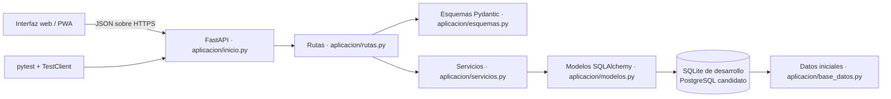
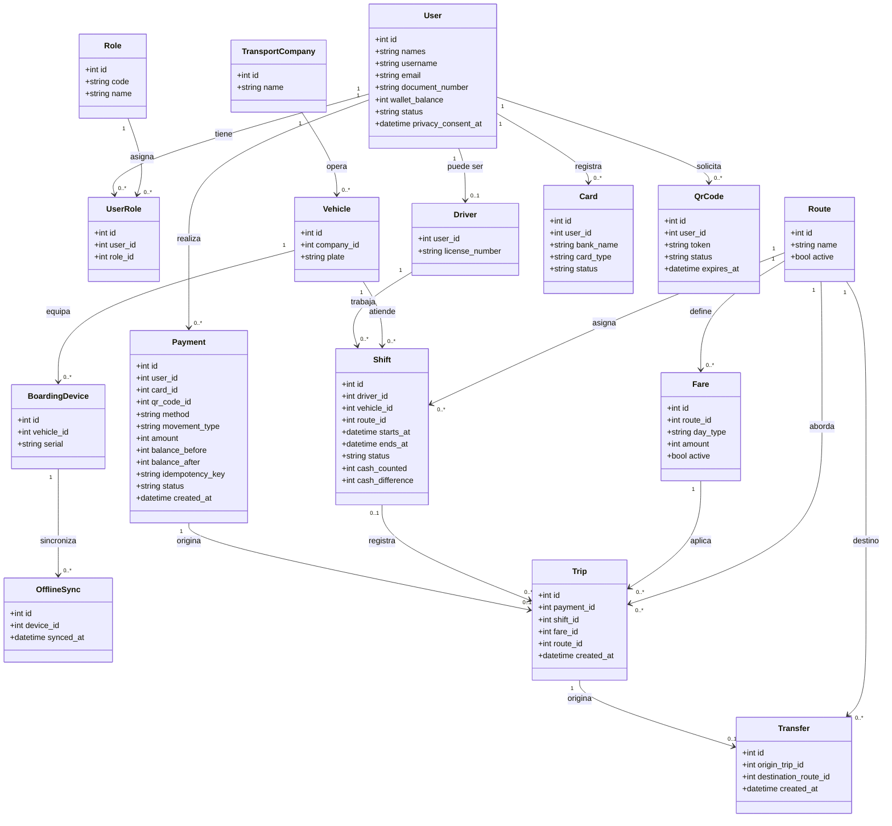
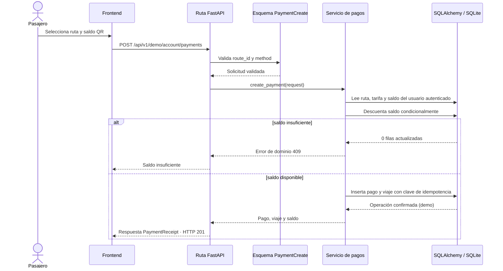
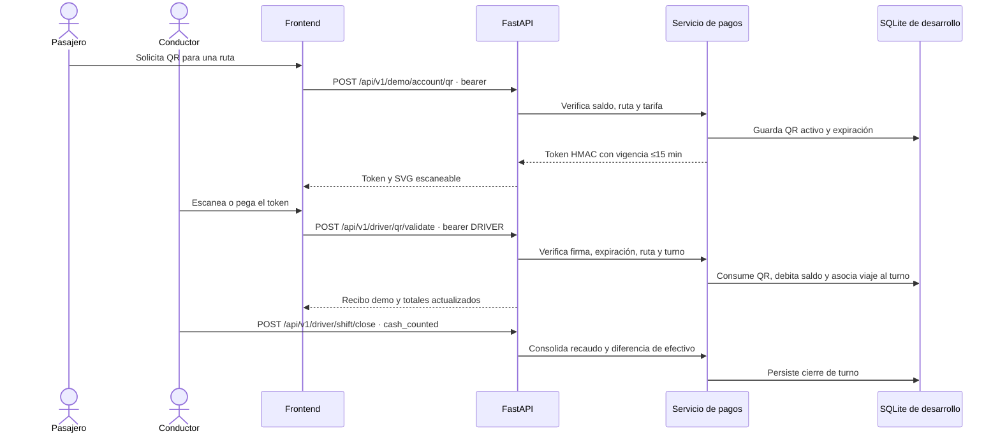

# Arquitectura inicial QrPass

## Diagrama de componentes



## Diagrama de clases / entidades



## Secuencia de pago con saldo



## Contrato de ejemplo

```http
POST /api/v1/demo/account/payments
Content-Type: application/json

{"route_id": 1, "method": "wallet", "idempotency_key": "pago-intento-0001"}
```

`method` acepta `wallet`, `cash` o `card`; si es `card`, debe incluir `card_type` (`debit` o `credit`). Las respuestas incluyen `mode: "demo"` y el estado `completed_demo` para no confundir la simulación con una autorización financiera real.

## Secuencia QR y turno conductor



La secuencia QR requiere conectividad con la API. HMAC sirve para este validador online; no se debe entregar el secreto a dispositivos offline.
