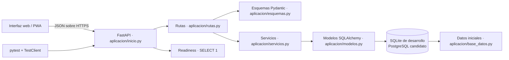
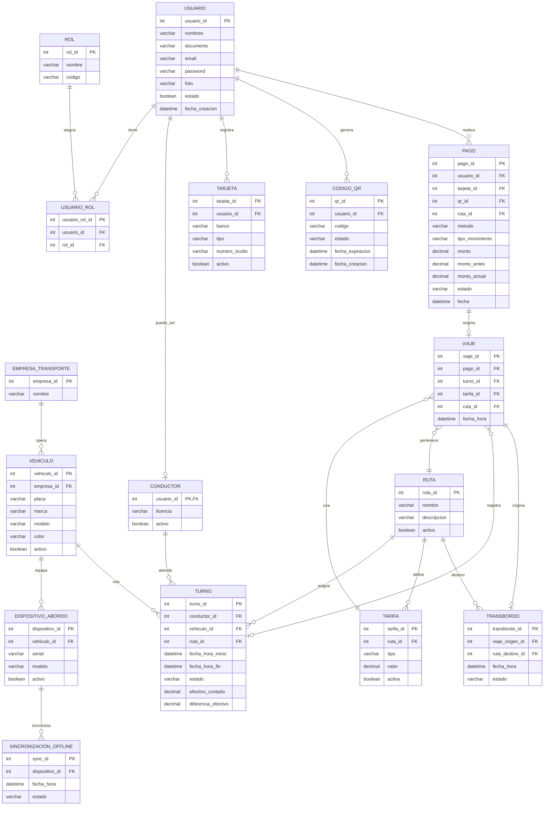
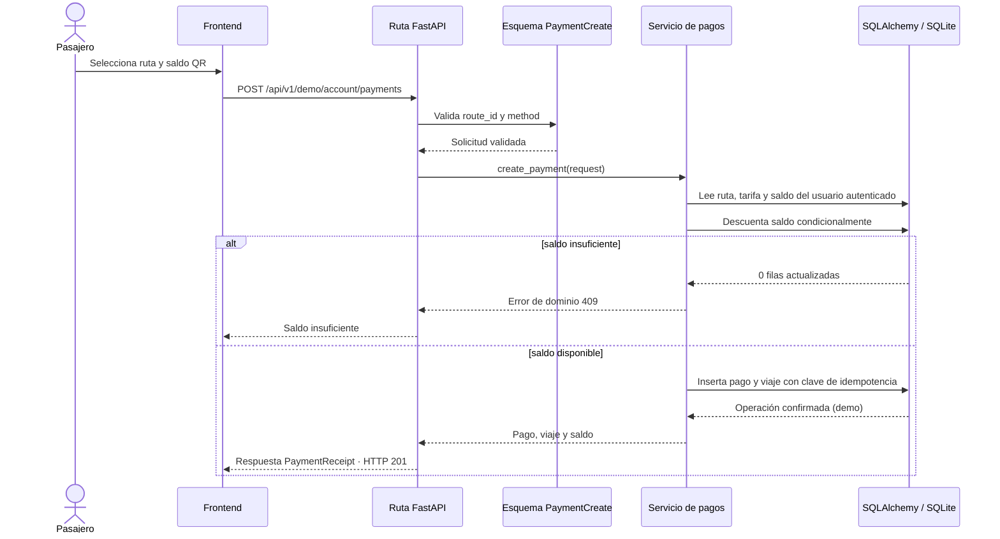
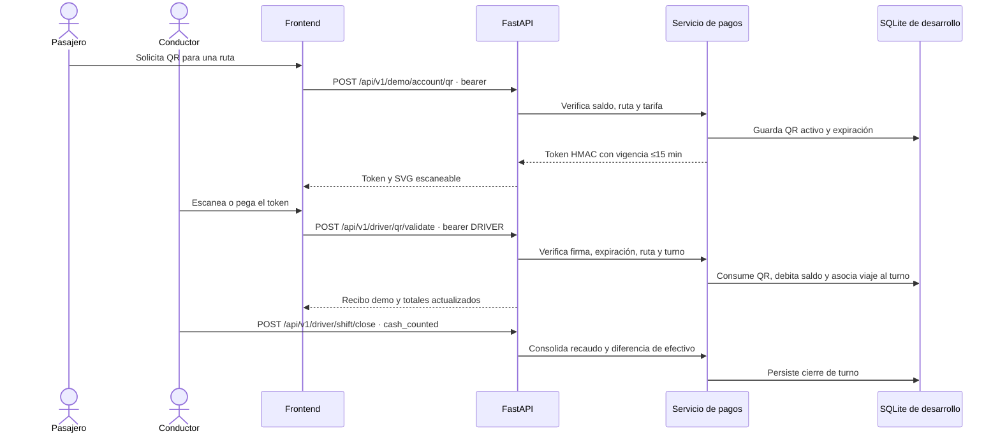

# Arquitectura inicial QrPass

## Diagrama de componentes



## Requerimientos de la especificación y alineación con el backend

La especificación formal del proyecto establece que QRPASS debe responder a tres tipos de requerimientos:

1. Requerimientos funcionales (RF): registro, autenticación, perfil, billetera, QR, pagos, transbordos, historial y cierre de turno.
2. Requerimientos no funcionales (RNF): operación offline, tiempos de respuesta, cifrado de credenciales y propiedades ACID.
3. Requisitos de dominio (RD): tarifa dinámica, protección de datos, normativa de transporte y reglas operativas del sistema.

### Requerimientos funcionales principales

- RF-01: registro y autenticación del usuario pasajero
  - Creación del usuario y asignación de rol.
  - Inicio de sesión y emisión de token JWT.
  - Consulta del perfil y saldo del usuario autenticado.
- RF-02: operación del conductor en la consola a bordo
  - Login operativo del conductor.
  - Inicio del turno con buseta y ruta.
- RF-03: cobro de pasaje por QR y tarjeta
  - Pago tipo SALIENTE mediante QR.
  - Pago tipo SALIENTE por tarjeta (débito/crédito).
- RF-04: generación y validación de QR
  - Generación de un QR asociado al usuario y su token.
  - Verificación de validez y estado del QR.
- RF-05: tarifa por ruta y tipo de día
  - Tarifa vigente según el calendario y la ruta.
- RF-06: cobro manual en efectivo
  - Registro del pase a bordo con efectivo y su conciliación.
- RF-07: billetera y recargas
  - Consulta de saldo disponible.
  - Registro de ingreso por recarga.
  - Historial unificado de pagos.
- RF-08: transbordos
  - Validación y autorización de transbordo a $0 COP bajo condiciones específicas.
- RF-09: historial de viajes
  - Listado del historial de viajes y consulta de detalle individual.
- RF-10: resumen de recaudo por turno
  - Balance consolidado del turno según medio de pago.
- RF-11: cierre de turno
  - Finalización del turno y cambio de estado del conductor.

### Requerimientos no funcionales

- RNF-01: modo offline para transmisión de transacciones acumuladas cuando la red recupere cobertura.
- RNF-02: tiempos de respuesta menores a 1.5 segundos.
- RNF-03: cifrado y manejo seguro de credenciales.
- RNF-04: propiedades ACID en cada transacción de débito/crédito.

### Requisitos de dominio

- RD-01: tarifa dinámica por calendario; se contempla $3.300 para días hábiles y $3.400 para festivos.
- RD-02: tratamiento de datos personales acorde con la Ley 1581 de Habeas Data y buenas prácticas de privacidad.
- RD-03: transbordos autorizados a $0 COP cuando el tiempo entre viajes es menor a 20 minutos y las rutas son distintas.
- RD-04: alineación con resoluciones del Ministerio de Transporte y requisitos legales operativos del sistema.

### Alineación actual con el backend

La implementación actual cubre gran parte del núcleo funcional del sistema y se apoya en las siguientes entidades del backend:

- `User`, `Role`, `UserRole` para acceso, perfiles y permisos.
- `Route`, `Fare` para tarifas y rutas.
- `QrCode`, `Payment`, `Trip` para pagos, QR y viajes.
- `Shift`, `Vehicle`, `Driver` para la operación del conductor.
- `Transfer` para el flujo de transbordo.
- `BoardingDevice` y `OfflineSync` para el diseño del modo offline.

La versión demo actual modela los roles `PASSENGER` y `DRIVER`. El bloque de administración que aparece en la especificación formal queda como extensión pendiente de diseño, no como rol activo del backend. Lo mismo ocurre con la sincronización offline completa: la base ya tiene las tablas de soporte y el flujo conceptual, pero la puesta en producción del lote masivo requiere una capa adicional de sincronización y validación de consistencia.

### Matriz funcional resumida recomendada

| ID | Descripción funcional | Endpoint equivalente en la API actual |
|---|---|---|
| RF-01.1 | Registro de pasajero | `POST /api/v1/auth/register` |
| RF-01.2 | Login y token JWT | `POST /api/v1/auth/login` |
| RF-01.3 | Perfil y saldo | `GET /api/v1/auth/me` + `GET /api/v1/demo/account` |
| RF-02.1 | Login del conductor | `POST /api/v1/auth/login` (login compartido); la autorización de conductor se valida después mediante rol |
| RF-02.2 | Inicio de turno | `POST /api/v1/driver/shift/start?route_id={id}` |
| RF-03.1 | Pago con QR | `POST /api/v1/driver/qr/validate` (verifica y consume QR, debita billetera y crea viaje) |
| RF-03.2 | Pago con tarjeta | `POST /api/v1/driver/shift/payments` o `/api/v1/demo/account/payments` (simulado; no consulta una tarjeta registrada ni un POS) |
| RF-04.1 | Generar QR | `POST /api/v1/demo/account/qr` |
| RF-04.2 | Validar QR | `POST /api/v1/driver/qr/validate` |
| RF-05.1 | Ver tarifa por ruta y día | `GET /api/v1/fares/current` |
| RF-06.1 | Cobro efectivo | `POST /api/v1/driver/shift/payments` |
| RF-07.1 | Consultar saldo | `GET /api/v1/demo/account` |
| RF-07.2 | Recarga | `POST /api/v1/demo/account/top-ups` |
| RF-07.4 | Historial unificado de ingresos y egresos | `GET /api/v1/payments/history` |
| RF-08.1 | Transbordo | `POST /api/v1/demo/account/transfers` |
| RF-09.1 | Historial de viajes | `GET /api/v1/trips` |
| RF-09.2 | Detalle de viaje | `GET /api/v1/trips/{trip_id}` |
| RF-10.1 | Resumen del turno | `GET /api/v1/driver/shift` |
| RF-11.1 | Cierre del turno | `POST /api/v1/driver/shift/close` (la especificación propone `PATCH`; se conserva POST porque el cierre es una acción que consolida y fija el turno) |
| RNF-01.1 | Sincronización offline | Modelado en `OfflineSync` y flujo de dispositivos |

Los recursos `/payments/history`, `/trips` y `/trips/{trip_id}` son endpoints nuevos alineados con la especificación. Las rutas anteriores bajo `/demo/account` se conservan para no romper la interfaz existente. El flujo de validación de QR sigue siendo una operación autenticada del conductor (`POST /driver/qr/validate`): no se expone la consulta pública por token sugerida en la matriz porque el QR es un token portador y su validación real también debe consumirlo y registrar el pago.

La alineación funcional no implica que todas las URI, métodos HTTP o integraciones sean idénticos a la matriz del PDF. En particular, el pago con tarjeta no usa una tarjeta registrada (`Payment.card_id` todavía no se asocia), el login de conductor reutiliza el login general y el cierre se modela como acción POST. La tabla muestra el contrato actual y explicita estas decisiones para no reportar como completo lo que solo es una simulación.

## Persistencia, transacciones y disponibilidad

- `get_session` entrega una sesión SQLAlchemy por solicitud. SQLite habilita `PRAGMA foreign_keys=ON` al abrir cada conexión.
- Débitos y recargas aplican el cambio de saldo y crean el pago (y, para pasajes, el viaje) en la misma transacción de base de datos. El commit es el límite de confirmación; si falla antes de terminar, el cierre de la sesión revierte los cambios pendientes.
- Hay controles de integridad para saldo no negativo, importes, unicidad de idempotencia y relaciones FK. Las claves de idempotencia ayudan a evitar aplicar de nuevo una petición reintentada; todavía falta probar explícitamente las carreras concurrentes sobre el motor productivo elegido.
- `GET /api/v1/health` es una señal de vida del proceso y no toca la base. `GET /api/v1/ready` ejecuta `SELECT 1`; devuelve 503 y deja registro de error si la base no está disponible. Esto verifica conectividad, no que migraciones, semillas o servicios externos estén listos.
- La base SQLite local se crea con `metadata.create_all` y conserva upgrades manuales de compatibilidad. Aún no hay historial de migraciones versionadas; cualquier cambio de esquema que deba conservar datos necesita migración explícita y prueba sobre una copia representativa.
- No existe cola de mensajería o sincronización offline operativa. No se debe introducir broker, protocolo de eventos o garantías de entrega hasta definir qué eventos se producen, cómo se identifican/reintentan y cómo se resuelven duplicados/conflictos entre dispositivos.

Las pruebas `test_failed_payment_commit_rolls_back_balance_payment_and_trip` y `test_failed_qr_redemption_commit_restores_qr_balance_payment_and_trip` inyectan una excepción justo antes del commit. Verifican que saldo, pago, viaje y, para QR, el estado de consumo se revierten juntos en la configuración SQLite de pruebas. Es evidencia de atomicidad, no una certificación de aislamiento/concurrencia o de una base productiva.

## Trabajo técnico siguiente, basado en brechas comprobadas

1. **Evolución del esquema:** sustituir los ALTER manuales por migraciones versionadas; definir la política de respaldo/recuperación antes de aplicar migraciones sobre una base con datos.
2. **Concurrencia transaccional:** probar dos solicitudes simultáneas con la misma clave idempotente, débitos con saldo justo y dos consumos del mismo QR. Los criterios deben incluir no saldo negativo, un solo pago/viaje y resultado estable para reintentos.
3. **Operación y comunicaciones:** documentar el contrato de errores/reintentos y límites de timeout. La API es síncrona HTTP hoy; la sincronización offline por lotes aún no está implementada.
4. **Integraciones financieras y a bordo:** antes de construir adaptadores hay que decidir proveedor/pasarela, POS, identidad de terminal, conciliación y modelo de riesgo offline. No hay evidencia de esas decisiones en el código o especificación disponible, así que quedan explícitamente abiertas.
5. **Validación no funcional:** medir latencia de extremo a extremo y carga objetivo en el despliegue elegido; las pruebas funcionales actuales no prueban umbrales de 1.5 s ni crecimiento de 200%.

## Diagrama de dominio (esquema actual en revisión)

El modelo sigue tomando forma; esta vista refleja la estructura base que aparece en el esquema de referencia, sin pretender que sea la versión final. La intención es mantener una relación clara entre usuarios, roles, rutas, pagos, QR, turnos y validación de viajes.



## Mapeo real al backend

Lo importante no es solo el diagrama: el dominio queda materializado en capas reales del proyecto.

- Modelo de persistencia: `servidor/aplicacion/modelos.py`
  - `User`, `Role`, `UserRole`, `Driver`, `TransportCompany`, `Vehicle`, `BoardingDevice`, `Route`, `Fare`, `Shift`, `Card`, `QrCode`, `Payment`, `Trip`, `Transfer`, `OfflineSync`
  - Aquí se definen keys, relaciones, constraints y reglas de integridad.

- Lógica de negocio: `servidor/aplicacion/servicios.py`
  - `create_payment`, `create_qr`, `create_top_up`, `create_transfer`, `close_driver_shift`, `redeem_qr`
  - Aquí se aplican reglas como saldo, tarifa vigente, duplicados por idempotencia, cierre de turno y validación del QR.

- API HTTP: `servidor/aplicacion/rutas.py`
  - Endpoints para `/auth`, `/demo/account` y `/driver`
  - Expone funcionalidades en capas: autenticación, viajes del usuario, pago, QR, recargas, transbordos y turno del conductor.

- Contratos de entrada/salida: `servidor/aplicacion/esquemas.py`
  - Define payloads y respuesta para rutas, pagos, tarjetas, top-ups, transferencias, turnos, QR y salud del servicio.

- Base de datos y semillas: `servidor/aplicacion/base_datos.py`
  - Crea la base SQLite en desarrollo, carga rutas, tarifas y usuarios demo, y prepara el entorno para pruebas.

La composición real es entonces:

`dominio / esquema -> modelos SQLAlchemy -> servicios -> rutas FastAPI -> esquemas Pydantic -> interfaz web`

Es decir, el esquema que dibujamos representa la estructura conceptual; el backend ya lo está implementando en las entidades y las reglas operativas que lo hacen funcionar.

## Aplicación del modelado orientado a objetos

Los ejercicios de gestión hospitalaria practican conceptos que también se usan en QrPass, pero el dominio y la arquitectura no se trasladan literalmente:

| Concepto | Ejercicio hospitalario | Aplicación en QrPass |
|---|---|---|
| Entidades | `Persona`, `Paciente`, `Medico`, `Cita` y `Atencion` | Modelos SQLAlchemy como `User`, `Driver`, `Route`, `Payment`, `Trip`, `Transfer` y `Shift`. |
| Generalización | `Paciente` y `Medico` heredan de `Persona`. | No se duplica una jerarquía de personas: `Driver` especializa a `User` mediante una relación uno a uno, mientras `UserRole` permite que un conductor tenga también rol de pasajero. |
| Asociaciones y multiplicidad | Una cita conecta a un paciente y un médico; las listas mantienen sus citas y una cita tiene cero o una atención. | Claves foráneas y `relationship()` expresan asociaciones; restricciones únicas y `CheckConstraint` protegen invariantes como un viaje por pago o un único transbordo por viaje. |
| Reglas y estados | Los métodos de `Cita` evitan atender citas canceladas, repetir atenciones o cancelar después de atender. | Los servicios aplican las reglas de pagos, QR, viajes, transbordos y turnos; los esquemas Pydantic validan solicitudes y la API traduce errores de dominio a respuestas HTTP. |
| Interacción y persistencia | Menú de consola, colecciones en memoria y exportación de texto. | Interfaz web/PWA y API HTTP; SQLite persiste el estado y los endpoints de historial consultan pagos y viajes. Las pruebas con `TestClient` verifican las operaciones y restricciones. |

La intención que se conserva es modelar el dominio, sus relaciones y sus reglas antes de implementar los flujos. No corresponde añadir al transporte conceptos hospitalarios como médicos, citas, atenciones o un menú de consola. Tampoco hace falta replicar la herencia o las listas en memoria: QrPass ya expresa esos conceptos mediante roles, relaciones ORM, servicios y persistencia. Para este alcance demo no se identifica una brecha funcional de modelado que requiera agregar código; las limitaciones operativas y de producción se registran en la trazabilidad.

## Secuencia de pago con saldo



## Contrato de ejemplo

```http
POST /api/v1/demo/account/payments
Content-Type: application/json

{"route_id": 1, "method": "wallet", "idempotency_key": "pago-intento-0001"}
```

`method` acepta `wallet`, `cash` o `card`; si es `card`, debe incluir `card_type` (`debit` o `credit`). Las respuestas incluyen `mode: "demo"` y el estado `completed_demo` para no confundir la simulación con una autorización financiera real.

## Secuencia QR y turno conductor



La secuencia QR requiere conectividad con la API. HMAC sirve para este validador online; no se debe entregar el secreto a dispositivos offline.
